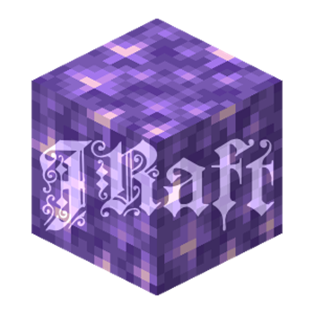

<p align="center">
  
</p>

<h1 align="center">JRAFT</h1>

<p align="center">Minecraft 26.3 with the JRAFT mods. Download, open, play. It installs and updates everything by itself.</p>

<p align="center">
  <a href="https://github.com/Lonezsi/jraft-launcher/releases/latest/download/jraft-windows.exe"></a>
</p>
<p align="center">
  <a href="https://github.com/Lonezsi/jraft-launcher/releases/latest/download/jraft-macos.zip"></a>
  <a href="https://github.com/Lonezsi/jraft-launcher/releases/latest/download/jraft-linux-amd64"></a>
</p>

Client-side JRAFT mods for **Minecraft 26.3 (Fabric)**, plus Grassrise, Grassrise Better Lighting, Euphoria Patches (with Complementary Reimagined) and Toast Control. One small app installs everything and keeps it updated.

## For players

1. Download the file for your system from [Releases](../../releases/latest):
   - Windows: `jraft-windows.exe`
   - Mac: `jraft-macos.zip` (unzip it to get `JRAFT.app`; works on both Apple Silicon and Intel)
   - Linux: `jraft-linux-amd64` (or `jraft-linux-arm64`)
2. Open it. Do this every time you want to play, because that's how you get updates. A small window shows a progress bar; click *Show log* to see details.

The app:

- downloads or updates the mods, resource packs and shaders,
- uses your Prism Launcher if you already have one (your accounts and other instances stay as they are), or downloads a portable [Prism Launcher](https://prismlauncher.org) if you don't (nothing gets installed, and the app keeps it updated for you),
- adds a JRAFT instance to it,
- starts the game.

The **first time**, Prism asks you to sign in with your Microsoft account; there's no other setup to click through. After that, running the app goes straight into the game.

**Several accounts?** You get a dropdown to pick one, with a *Don't ask again* box. To switch later, click *Switch account* while the app says "Playing as ...". Prism downloads the right Java by itself.

Everything lives in its own folder (`%APPDATA%\jraft` on Windows, `~/Library/Application Support/jraft` on Mac, `~/.local/share/jraft` on Linux). Your normal Minecraft worlds and settings aren't touched. Mods you add to the instance's `mods` folder yourself are left alone.

**Mac:** the first time, right-click `JRAFT.app`, choose *Open*, then *Open* again (it isn't notarized by Apple). If macOS says it's damaged, run `xattr -cr ~/Downloads/JRAFT.app` in Terminal once.
**Linux:** `chmod +x jraft-linux-amd64`, then double-click it or run `./jraft-linux-amd64`.

**Shaders:** go to Options → Video Settings → Shader Packs and pick the Complementary pack that has *EuphoriaPatches* in its name. Euphoria Patches creates that pack the first time the game starts. Rethinking Voxels is also included, for voxel lighting (Euphoria Patches doesn't work on it).

## For the maintainer

| File | What it is |
|---|---|
| `pack/pack.json` | The list you edit: Modrinth slugs for mods, resource packs and shaders, plus direct-URL extras (CurseForge). `strip` names paths inside a pack's zip that the launcher deletes after downloading it, for packs whose license doesn't allow hosting a fixed copy. |
| `pack/lock.json` | Generated. Exact files, URLs and sha512 hashes. This is what the app downloads. |
| `pack/overrides/` | Default configs and `options.txt` (taken from the maintainer's own setup). They're copied only if the player doesn't already have that file. |
| `pack/packs/` | The JRAFT merge resource packs, `jraft-grass.zip` and `jraft-leaves.zip`, built by `tools/mergepacks/merge.py` (readable sources in `pack/packs-src/`). Downloaded from this repository. |

**Updating mods:** run the **Update mods** action on GitHub (Actions tab → Update mods → Run workflow), or run it locally:

```bash
go run ./cmd/lockgen
```

It picks the newest 26.3 Fabric build of every entry and pulls in required dependencies. Mods without a 26.3 build are listed under `skipped` in `lock.json`, and they're added automatically once they update. Editing `pack.json` on `main` also triggers the action.

**Merge packs:** several grass and leaf packs replace the same files, so only the top one would show. `jraft-grass` and `jraft-leaves` sit above them and combine them: merged blockstates that use every pack's models (Grassrise, Simple Grass Flowers, Os' Colorful Grasses, Simple Foliage, Grass Clovers, Bushier Bushes, Connected Paths), and Better Leaves' bushy shape with Os' Colorful Leaves' textures. They only reference the other packs' models and textures by name; the only copied files are MIT-licensed Better Leaves ones. The packs they use are pinned in `pack.json`. Before changing one of those pins, run `python tools/mergepacks/merge.py --vanilla <26.3 client jar>`: it rebuilds both packs and fails if any model or texture they point at is missing or comes from the wrong pack. Then run lockgen.

**Changing Minecraft version:** change `"minecraft"` and `"resourceFormat"` (the client jar's `version.json` `pack_version`, e.g. `97.1` for 26.3) in `pack.json` and regenerate the lock.

**Releasing the app:** `git tag v1.0.0 && git push --tags`. The Release action builds the Windows exe, the Mac app and the Linux binaries. You only need a new release when the app itself changes, not when mods change.

**Testing locally without touching your real install:**

```bash
JRAFT_DIR=/tmp/jraft JRAFT_PACK_DIR=./pack JRAFT_NO_LAUNCH=1 go run ./cmd/jraft
```

The app writes a log to `launcher.log` in its folder (`%APPDATA%\jraft` on Windows).

## Notes on the mod list

Distant Horizons draws far terrain, with render distance set to 5 by default. Voxy is left out until it has a 26.3 build; swap it in for `distanthorizons` in `pack.json` then (never both). Sound Physics Perfected joins automatically once it updates.

Dropped on purpose: Chisels & Bits (not on Modrinth), Physics Mod (FPS), Super Fast Math (not on Modrinth), server-side mods like Item Rename, Noisium, Lithium, C2ME, Clumps, Collective, Villager Names and IPLA (Simple Voice Chat stays, so put it on the server too). The original pack's custom resource packs aren't included.

**Icon:** Replace `assets/icon-source.png`, then `go run ./tools/icon` rebuilds `assets/icon.png` and `assets/icon.ico`. After changing it, regenerate the Windows resource with `go run github.com/tc-hib/go-winres@v0.3.3 simply --icon assets/icon.png --arch amd64,arm64 --product-name JRAFT --file-description "JRAFT launcher" --out cmd/jraft/rsrc`.
